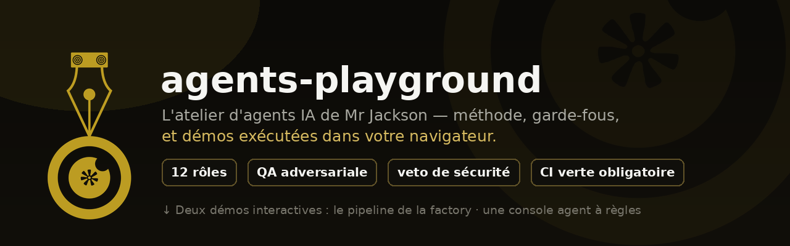

<div align="center">



**Interactive demos of Mr Jackson's AI-agent methodology · running 100 % in your browser.**

[](LICENSE)
[](demo/)
[](demo/)
[](demo/)
[](README.md#what-this-is-not)

**[🇫🇷 Version française](README.fr.md)** ·
[**▶ Open the demo**](https://mr-jacks0n.github.io/agents-playground/)

</div>

---

Two interactive tabs, one purpose: *show how real, industrialized AI agents are
built · and what guard-rails they go through* · without pretending anything is
running live.

## What you get

### 🏭 Tab 1 · Factory multi-agent pipeline (simulated)

Type an idea for a software feature. A simulated agent chain reproduces the real
method used in [LanceFer](https://github.com/Mr-Jacks0n/LanceFer):

```
Orchestrator → Architecte → Ingénieur → QA (tests + adversarial)
→ Auditeur sécurité (VETO possible) → Gatekeeper release
```

- Deterministic: the same idea always produces the same run (seeded PRNG, `mulberry32`).
- The **security auditor** scans your idea against a risk lexicon
  (hard-coded secrets, `eval()`, unencrypted HTTP, destructive ops, personal data…)
  and can **veto** the release · exactly the safety posture used in the real factory.
- A gated release is the *only* outcome when the input is risky. That's the point.
- The numbers referenced in the UI are real repo stats (145 Node + 59 JVM tests
  on LanceDrop), not invented ones.

### 🤖 Tab 2 · Rules-based agent console (mini-ARIA)

A miniature of [ARIA](https://github.com/Mr-Jacks0n/IA), Mr Jackson's personal
learning agent:

- intent matching (no magic: recognizable, readable rules),
- session memory ("mémorise que …"),
- a **transparent reflection trace** · the agent shows how it reasons,
- a **safe arithmetic parser with a whitelist** · the direct lesson from the
  real `eval()`/DoS audit on ARIA.

Everything lives in the page. Reload = clean slate.

### 📐 Tab 3 · The method

Six cards linking each simulated concept to the real repo where it lives.

## What this is *not*

- ❌ Not a live LLM, not a chat UI to any model · no API keys, no inference.
- ❌ Not connected to the network. No telemetry, no persistence beyond the page.
- ❌ Not a claim that agents are "running" here. It is a labeled **simulation**
  of mechanics and guard-rails, with honest links to the real repos
  ([LanceFer](https://github.com/Mr-Jacks0n/LanceFer),
  [IA](https://github.com/Mr-Jacks0n/IA)) where they actually exist.
- The watermark bottom-right always reminds you: *SIMULATION EXÉCUTÉE DANS VOTRE
  NAVIGATEUR · AUCUN LLM · AUCUN RÉSEAU*.

## Run it locally

```bash
git clone https://github.com/Mr-Jacks0n/agents-playground.git
cd agents-playground/demo
python3 -m http.server 8000
# → http://localhost:8000
```

## Repository layout

| Path | Role |
|---|---|
| `demo/index.html` | 3-tab shell (pipeline · mini-ARIA · method) |
| `demo/pipeline.js` | pipeline engine: PRNG, plan generation, risk lexicon, per-stage logs, verdict |
| `demo/aria.js` | mini-agent: intents, session memory, reflection trace, safe parser |
| `demo/main.js` | DOM orchestration: tabs, stage animation, chat binding |
| `demo/styles.css` | brand tokens (gold `#bc9c22` on near-black), flow grid, chat, trace |
| `demo/banner.png` | header banner, built from the official Mr.Jackson brand kit |

## License

MIT © 2026 [Mr Jackson](https://github.com/Mr-Jacks0n)
